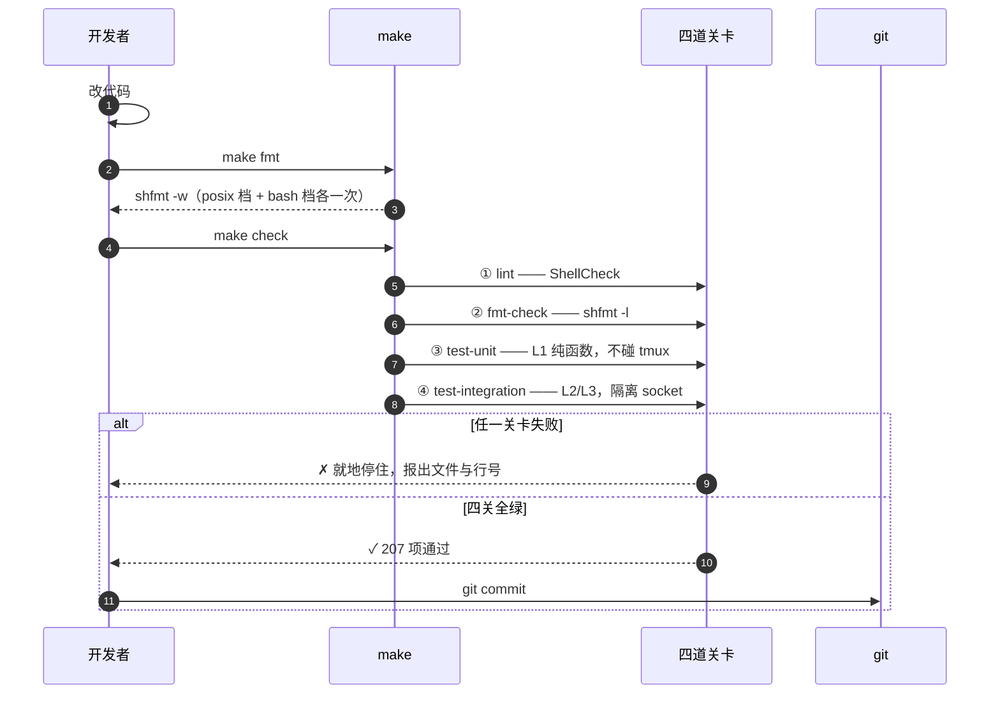
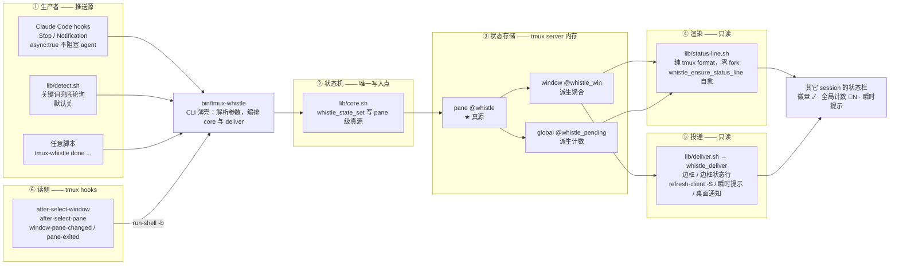

# 开发文档

面向**改这个仓库的人**。只想用插件的话看 [README](../README.md)。

## 从零跑起来

```sh
git clone https://github.com/rich1e/tmux-whistle.git
cd tmux-whistle
make deps        # 装 bats-core / shellcheck / shfmt
./install.sh     # 链接 + 写 tmux.conf.local + 装 Claude Code hooks
```

然后重载 tmux 并自检：

```sh
tmux source-file ~/.config/tmux/tmux.conf    # 或 prefix + r
tmux-whistle doctor
```

`install.sh` 会把仓库软链到 `~/.local/share/tmux-whistle`，所以**改完代码直接 `prefix + r` 即可**，
不用重装。装到别处或要卸载：`./install.sh --uninstall`。

## 开发命令

```sh
make help             # 列出全部目标
make deps             # 装 bats-core / shellcheck / shfmt
make lint             # ShellCheck
make fmt              # shfmt 原地格式化
make fmt-check        # 格式检查（CI 用）
make test-unit        # L1 纯函数单测，不碰 tmux
make test-integration # L2/L3，隔离 socket
make check            # 提交前跑这条 = lint + fmt-check + 全部测试
make clean            # 清临时产物
```

**跑单个测试：**

```sh
bats test/integration/badge.bats                # 单个文件
bats -f 'menu-args' test/integration/cli.bats   # 按用例名正则过滤
bats --print-output-on-failure test/unit        # 失败时打印输出
```

## 提交流程

```
改代码 → make fmt → make check → git commit
```

`make check` 是唯一需要记住的命令 —— 它已经把该跑的跑完了。四道关卡依次过，
任一关红了就就地停住；全绿才允许提交：



关卡的分工是刻意的：**ShellCheck 兜底 POSIX 合规**（`shell=sh` 下 `[[ ]]`、数组、
`mapfile` 会直接报错），**测试才是唯一能抓静默出错的地方**（比如 pane/window 同名
option 的影子遮蔽 —— 代码完全正常，只有断言最终 option 值才会红）。

## 目录结构

```
.
├── bin/
│   └── tmux-whistle            # CLI，用户入口：解析参数后调 core/deliver
├── lib/
│   ├── core.sh                 # 状态机，唯一状态写入点；含三个不碰 tmux 的纯函数
│   ├── status-line.sh          # 徽章 format 生成、幂等注入、读侧 hooks 注册
│   ├── deliver.sh              # 投递：边框 / 边框状态行 / 状态栏刷新 / 瞬时提示 / 桌面通知
│   ├── detect.sh               # 关键词兜底检测（默认关，会误报）
│   └── install-hooks.sh        # Claude Code settings.json 的幂等合并器
├── hooks/
│   └── claude-code.sh          # Claude Code hook 适配器：stdin JSON → 状态
├── scripts/
│   └── setup.sh                # 插件加载时的初始化：发布 mark、幂等 patch、注册 hooks
├── share/
│   └── whistle.zsh             # 可选 OSC 133 片段
├── test/
│   ├── unit/                   # L1 纯函数测试
│   │   └── core.bats
│   ├── integration/            # L2 tmux 集成测试（隔离 server）
│   │   ├── badge.bats
│   │   ├── border.bats
│   │   ├── border_status.bats
│   │   ├── cli.bats
│   │   ├── deliver.bats
│   │   ├── hooks.bats
│   │   ├── install_hooks.bats
│   │   ├── run.bats
│   │   └── state.bats
│   ├── e2e/                    # L3 CLI + hook 端到端
│   │   └── claude_hook.bats
│   └── test_helper/
│       └── whistle.bash        # Bats 公共 helper：隔离 server + 断言
├── docs/
│   ├── development.md          # 本文档
│   ├── notify-design-review.md # 「事件收件箱」形态的取舍评审
│   ├── requirements-analysis.md
│   ├── superpowers/            # 执行计划（plans/），带 checkbox 的步骤清单
│   └── todo.md                 # 已知问题与功能待办
├── tmux-whistle.tmux           # tpm / tpack 入口（可执行文件，tpm 不 source 它）
├── .tmux-whistle.conf          # tmux conf：prefix + W 绑定 + 调 setup.sh
├── install.sh                  # 手动安装 / 卸载
├── Makefile                    # 统一开发命令
├── README.md                   # 使用者文档
├── CLAUDE.md                   # 给 Claude Code 看的仓库说明
├── .editorconfig               # 缩进 / 续行风格（与 shfmt 共用）
├── .shellcheckrc               # ShellCheck 配置（shell=sh 兜底 POSIX 合规）
├── .gitignore
└── .github/
    └── workflows/
        └── ci.yml              # CI：macOS + ubuntu 上跑 make check
```

下面三个文件是 tpm 路径的**硬依赖**，少一个就装不起来：

| 文件 | 为什么必须是可执行文件 |
|---|---|
| `tmux-whistle.tmux` | tpm 把插件目录下的 `*.tmux` 当**可执行文件**运行，不 source |
| `scripts/setup.sh` | 由 `.tmux-whistle.conf` 的 `run-shell -b` 拉起 |
| `hooks/claude-code.sh` | 由 Claude Code 按 `settings.json` 里的路径 spawn |

> `HANDOFF.md` 是本地的任务交接快照，已在 `.gitignore` 里，不属于仓库内容。

## 架构与运行原理



四条运行原理，都对应图上的一段：

**推送，不是轮询。** tmux 的 hook 只能感知 tmux 内部事件（pane 退出、窗口切换、bell），
**不存在**能表达「agent 做完了任务」的 tmux 事件 —— 那不是 tmux 的概念。所以推送的发起方
必须在 agent 侧（图 ①），由 Claude Code 的 hook 机制在 `Stop` / `Notification` 时真实
spawn 一个子进程。配 `"async": true` 后 Claude Code 不等它退出，整条链路（含 osascript
的几十毫秒）都在 agent 的关键路径之外。

**唯一写入点。** 只有 `lib/core.sh` 能写状态（② → ③）。渲染与投递（④⑤）只读不写，
所以「换掉 agent 集成方式」不会碰到渲染代码。状态存在 tmux server 内存里 —— pane 级
`@whistle` 是真源，window / global 级全是派生聚合值，重算即可；pane 一死状态自动消失，
**零清理逻辑**，也不跨 tmux 重启（通知本就不该有陈旧残留）。

**徽章零 fork。** 状态栏每 `status-interval` 重算一次，写成 shell function 就会每次刷新
都 fork 一个 `sh -c`。所以徽章必须是 tmux 原生 format 算得出来的东西（④），整段串存进
global option `@whistle_mark`，用户配置里只留 `#{E:@whistle_mark}` 占位符。

**投递要破门控。** 改 `@whistle` 只是把状态栏**标脏**，真正重画要等下一个
`status-interval`（配 10 秒就是延迟 10 秒才出现）。所以 `whistle_deliver` 必须显式对
相关 client 发 `refresh-client -S`（`-S` = 只刷状态栏不重画 pane）。

**自愈优先于抢时序。** oh-my-tmux 在 source 完 `tmux.conf.local` **之后**才重算主题，会覆盖
早先打的补丁；固定延迟是竞态。所以状态栏注入不在加载时做，而在**真正要显示的那一刻**
（`whistle_deliver` 开头）重做一遍 —— 幂等，是唯一不依赖加载顺序的时机。

**读侧只管「已读」。** 已读 = 焦点进入（你把窗口切过去了），不是「点击确认」（后者会让人
养成忽略弹窗的习惯）。tmux hooks（⑥）只负责清除状态与重算聚合，**推送侧完全不碰
tmux hooks** —— 有人往 pane 里敲命令不会触发通知。

## 改代码时的红线

下面每一条都踩过 —— 违反了不会报错，只会**静默出错**。完整版见 [`CLAUDE.md`](../CLAUDE.md)。

**POSIX sh（目标 shell 是 macOS 的 `/bin/sh`）**

- **没有局部变量**。函数里的临时变量会覆盖调用方的同名变量 —— 临时变量一律带命名空间前缀
  （`_ws` / `_l*` / `_p*` / `_c*` / `_d*`）。
- 禁用 `[[ ]]`、数组、`local -n`、`mapfile`、`$'...'`。ShellCheck 的 `shell=sh` 会兜住大部分。
- `$var` 紧跟中文/全角字符必须写 `${var}`，否则字节被吞进变量名。

**tmux 调用**

- `tmux show` **必须带 `-v`**，否则读回的是 `名称 "值"` 整行，写回去会毁掉用户状态栏。
- **pane 与 window 不能用同名 user option** —— 会影子遮蔽：清掉 pane 的 `@whistle` 后查找回退到
  window 的聚合值，pane 看起来"清不掉"。
- **`run-shell` 会阻塞 tmux 命令队列**，绝不能排在 `\;` 链中间。
- **`set-hook` 必须用命名 array key**（`after-select-window[whistle]`）。不带 key 会清空整个数组
  顶掉别的插件；用 `-a` 又会在重复 source 时越加越多。
- **`display-menu` 的条目参数是 tmux 命令，不是 shell 命令**。要调外部程序必须包在
  `run-shell -b '...'` 里，否则 tmux 会把路径当命令名 → `Unknown command: <path>`。
- 嵌套 `#{?...}` 条件式的大括号必须配平 —— 畸形 format 会被 tmux **静默渲染成空字符串**。

**其它**

- 进入 tmux format 的文本必须过 `whistle_sanitize`（剔掉 `# { } |` 与控制字符，默认截断 80 字符；第二参可改上限，正文用 400）。
- **不要删 `whistle_deliver` 开头的 `whistle_ensure_status_line`** —— oh-my-tmux 在 source 完
  `tmux.conf.local` 之后才重算主题，会覆盖状态栏补丁；自愈是唯一不依赖加载顺序的时机。
- `lib/install-hooks.sh` 合并 `settings.json` 时只增删带 marker 的条目，**绝不覆盖用户已有的 hook**。
- `lib/core.sh` 里 `whistle_sanitize` / `whistle_rank` / `whistle_aggregate` /
  `whistle_count_states` 四个函数**不得出现任何 tmux 调用** —— 这是 L1 单测能脱离 tmux 跑的前提。

## 测试约定

| 层 | 目录 | 依赖 | 目标 |
|---|---|---|---|
| L1 | `test/unit/` | 无（不碰 tmux） | 纯函数：消毒 / 优先级 / 聚合 / format 构建 |
| L2 | `test/integration/` | `tmux -L` 隔离 server | 渲染、注入幂等、边框可还原、hooks |
| L3 | `test/e2e/` | 隔离 server + 构造的 hook JSON | CLI 与 hook 的完整链路 |

helper（`test/test_helper/whistle.bash`）的约定：

- 每个测试文件一个独立 socket（`tmux -L whistle-test-$$`），用 `-f /dev/null` 起 server，
  绝不读用户真实的 `tmux.conf`。
- **绝不在 helper 里装 `trap ... EXIT`** —— 会覆盖 bats 自己的 trap，静默吞掉测试失败
  （表现是 `Executed N instead of expected M`，而不是 `not ok`）。清理交给 `teardown()`。
- `teardown` 必须 kill-server **并显式删掉 socket 文件**（`kill-server` 不总会 unlink）。
- `display -pF` 不解析 `#[...]` 样式，断言前要剥掉（helper 的 `wt_render_windows` 已处理）。
- hook 走 `run-shell -b` 是异步的，断言前用 `wt_wait_until` 轮询，别 sleep 一下就假定好了。

## 风格

- 注释与用户可见文案一律中文；代码标识符英文。
- `shfmt` 按方言分两次调用（`-ln=posix` 给 `bin/ lib/ hooks/ install.sh`，`-ln=bash` 给
  `test/**/*.bash`）。**`.bats` 不是合法 bash，shfmt 解析不了**，格式化与格式检查都排除，
  这些文件靠 review 保证风格。
- `.shellcheckrc` 的 directive 不接受 `=` 两侧的空格（带空格会报 SC1134）。
- 缩进 2 空格、续行风格见 `.editorconfig`，shfmt 与编辑器共用。

## CI

`.github/workflows/ci.yml` 在 macOS 与 ubuntu 上跑 `make check`。ubuntu 那份顺便验证
`notify-send` 缺失时的降级路径不报错。
